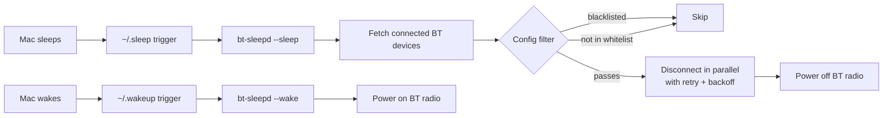

*This is the written version of my DevFest 2026 talk, **Beyond CRUD: build your own internal cloud, one trade-off at a time**. If you'd rather read the slides, [the full deck is here as a PDF](/downloads/beyond-crud-devfest-2026.pdf). But start with the story, because the talk actually starts before the talk.*

## It started with my earphones

About a year ago, when I was still on a Mac, I had one problem that annoyed me more than it should have.

Whenever I closed the laptop lid, macOS did **not** disconnect my Bluetooth earphones. The connection just... stayed there, quietly held by a machine that was supposedly asleep. And I am a forgetful person. Most of the time I wouldn't manually disconnect anything. I'd just close the lid, pocket the earphones, and go.

Then later, I'd be out somewhere (standing in a daladala, squeezed into a bajaji, riding across town), pull out my phone, and try to connect my earphones.

Nothing.

Because my Mac, sitting at home with the lid closed, was still holding the Bluetooth connection hostage.

If this has never happened to you: your phone shows the earphones as *connected*, but no audio comes out. The only fix is to disconnect them from the Mac first. So there I was, in public transport, opening my entire laptop in a moving bajaji just to click a Bluetooth icon and free my own earphones.

This happened a lot. Like, *a lot* a lot.

One day I'd had enough. I said, fuck this. I'm a software engineer. I have to fix this.

## So I wrote bt-sleepd

I searched around for `sleep watcher mac os` and found [`sleepwatcher`](https://www.bernhard-baehr.de/), a tiny old macOS daemon that runs scripts whenever your Mac sleeps and wakes. It's been around forever. It does one thing: fire `~/.sleep` when the machine sleeps, and `~/.wakeup` when it wakes.

That was the trigger I needed. The *fix* itself, I wrote in Go: [**bt-sleepd**](https://github.com/tacheraSasi/bt-sleepd).

The idea is simple. When the Mac sleeps, disconnect every connected Bluetooth device and power off the Bluetooth radio. When it wakes, power the radio back on. Your earphones are suddenly free the *moment* the lid closes, so they reconnect to your phone instantly. No more opening a laptop in traffic.

Here's the whole flow:



Concretely, this is what happens:

1. **sleepwatcher** (installed via Homebrew, running as a `launchd` service) notices the Mac is going to sleep and runs `~/.sleep`.
2. That script calls `bt-sleepd --sleep`, which shells out to [`blueutil`](https://github.com/toy/blueutil), a tiny CLI for macOS Bluetooth, to list every connected device as JSON.
3. Each device goes through a filter: a **blacklist** (never disconnect my keyboard and mouse, please) and/or a **whitelist** (only touch the headphones). Matching is case-insensitive, against both the device name and MAC address.
4. Every surviving device gets disconnected **in parallel**, one goroutine per device, because disconnecting five devices one-by-one is slow, and you're racing the actual sleep event.
5. If a disconnect fails, it retries with **exponential backoff and jitter**: 1s, 2s, 4s, capped, with some randomness so retries don't stampede.
6. Then, if your config says so, it powers off the Bluetooth radio entirely: `blueutil --power 0`. This is the step that actually stops AirPods from clawing their way back.
7. On wake, `~/.wakeup` runs `bt-sleepd --wake`, which powers the radio back on. macOS re-pairs your stuff normally.

And because I didn't want to hand-edit shell scripts, `bt-sleepd --install` generates the `~/.sleep` and `~/.wakeup` scripts for you, with the correct Homebrew paths for Intel and Apple Silicon, and logging wired into `/tmp/bt-sleepd.log`. There's a `--dry-run` mode to preview what would be disconnected without touching anything, and a JSON config at `~/.config/bt-sleepd/config.json`:

```json
{
  "blacklist": ["keyboard", "mouse", "trackpad"],
  "power_off_bt": true,
  "retry_count": 3,
  "retry_delay": 1
}
```

Small tool. One job. Maybe a few hundred lines of Go. But it *removed me from a loop*. I will never again open a laptop in a moving vehicle to click a Bluetooth icon.

Keep that feeling in mind, because it's the whole talk.

## The pattern I didn't see yet

Here's what I love about that story in hindsight.

I didn't buy new earphones. I didn't switch to a different OS. I didn't file a bug report and wait. I noticed a piece of **infrastructure** misbehaving, and I wrote software to fix it: software that watches for an event, reacts, and removes the human from the loop.

*In a way, I fixed my infrastructure with software I wrote.*

And about a year later, I'm on stage at DevFest with a talk called **Beyond CRUD**, and the thesis is exactly the same instinct, just at a bigger scale: you can build *real* infrastructure (provisioning, deployments, logs, SSL, the whole thing) with Go, cheap VPS APIs, and the willingness to fix your own problems.

Here's the talk, beat by beat.

---

## You run a small agency

The talk opens with a setup, not a slide of code.

You run a small agency. Twelve clients. Fifteen servers across three regions. One engineer: you. Different clients, different stacks: Laravel, Go, Next.js, Postgres, Redis. And you're also the developer, the DevOps team, and the on-call rotation.

The architecture diagram is a person. That person is you.

## Every server comes with a second job


Every server comes with a second job. You create users and keys. You configure the firewall. You install the runtime. You write the nginx vhost, issue the certificate, set the environment variables, deploy the app, restart the process, read the logs, watch the metrics, run backups, and patch the box.

Same checklist on every server. Different stack. Fifteen times over.

The work isn't hard. It's just endless.

## The math is not on your side


Fifteen servers times twelve manual jobs is **one hundred and eighty tiny operations**. And every deploy, every certificate renewal, every client change resets the board.

You are the cron job.

## So you write the wish list


So you write down what you actually want. One internal dashboard where you can provision servers, manage their lifecycle, deploy, configure nginx, issue SSL, read logs, watch metrics, run commands, manage env and secrets, domains, backups, and SSH keys.

This is an internal tool for your team, **not a SaaS**. No Kubernetes. No Terraform. No AWS. Just Linux, Go, and cheap VPS APIs.

## Step 1: start with the box


You start with the box. Hetzner and Contabo already have APIs. You don't need a data center.

Your dashboard calls your Go API. Your API calls the provider. The provider creates the VPS. And **cloud-init** does the first-boot setup: users, SSH keys, packages, firewall, runtime.

The provider gives you a machine. Cloud-init gives it a personality.

One click replaces a 40-step checklist. The checklist is just code now. The trade-off: you write more API code and you have to track state yourself, but you never click through a provider dashboard again.

## The API said yes. The server wasn't ready.

One thing that bites everyone: the provider API returning `200` does **not** mean the server is ready. It means *accepted*.

So you track the lifecycle explicitly (`requested`, `creating`, `initializing`, `installing`, `ready`, and the failure branch nobody draws). You can also start, stop, reboot, and destroy the box.

But only the box.

## The box is not the app


And here is the gap. The provider API manages the box: create, start, stop, reboot, destroy. But it has no idea what's *inside*.

Your app, nginx, TLS, environment, logs, cron. None of that is a provider API call.

The provider gives you a machine. It does **not** give you a deployment.

## Option 1: let the backend SSH in


The obvious option is to let your backend SSH into the VPS and run a command. Tools like Laravel Forge use exactly this model: connect, run the deploy script, disconnect.

One private key. Fifteen servers. It works.

For three servers, it's excellent. And honestly? SSH is still great for *humans*. Hold that thought.

## You try it. Then the trade-offs show up.


Then the trade-offs show up.

- **Key custody:** one key opens fifteen doors.
- **Inbound surface:** port 22 is exposed on every VPS.
- **Ephemeral connections:** a drop leaves you guessing.
- **Concurrency:** fifteen sessions, retries, partial failures.
- **Observability:** an exit code is not a live log.

And if someone compromises the control plane, or one server that holds the keys, they inherit access to every client.

For three servers, fine. For fifteen, you are building an SSH orchestration engine, and you *still* don't know what's happening inside.

## The low point


You set out to remove the human from SSH.

You built a computer that SSHs into every server.

Yes. That is the downgrade.

## Option 2: give every server an agent

So you install an agent. Cloud-init can do it on new VPSs; one command can do it on existing ones. The agent can run deploy scripts, configure nginx, issue SSL, stream logs, run commands.

But wait. How does your backend *send it work*?

If the backend calls the agent over HTTP, you've just opened another inbound port. You replaced SSH with SSH in a new coat.

## So you flip the connection


So you flip it.

No inbound request goes into the VPS. The agent opens an **outbound WebSocket** to your control plane and keeps it open. The control plane never dials in.

No inbound SSH for platform work. No inbound agent port. The agent calls home.

The trade-off: you need reconnect logic and a job backlog. In exchange, you remove the inbound surface completely.

This is the decision that makes the agent safe.

## The communication loop


This is the heart of the whole thing. One click. No terminal. No polling.

1. The browser posts the deploy to the Go API with a JWT.
2. The API checks ownership and writes a job to Postgres. The job is *pending*.
3. The agent already has a persistent outbound WebSocket. The API pushes a lightweight job trigger over that socket.
4. The agent **claims the job atomically**, executes the local action, and streams logs back.
5. The API publishes each log to the WebSocket hub first, so the browser sees it *live*. Goroutines persist the logs asynchronously, so the database never slows the live path.
6. When the agent finishes, it marks the job complete. The UI updates. You can notify by email, SMS, or webhook.

No SSH session. No polling. No terminal.

## You secure every hop


Three credentials. Three relationships. They never mix.

Your browser authenticates with a JWT, then trades it for a **one-time WebSocket ticket** that expires in sixty seconds. The agent authenticates with a **per-VPS token** stored on the VPS, revocable and rotated if compromised. Every job is claimed atomically, and every log stream is scoped to the owner of that server.

No inbound port. No shared SSH key. No anonymous job.

And your own root SSH access stays yours. The platform just stops using it. SSH is still excellent for humans. It's a poor foundation for a distributed control plane.

## The internal tool, end to end


Zoom out once. Your team uses a dashboard. The dashboard talks to a Go API with Postgres, Redis, a WebSocket hub, a job backlog, and async log writers. The API talks outbound to agents on each VPS. Provider APIs handle the lifecycle of the box.

One dashboard. One control plane. Many servers.

It's an internal tool, not a SaaS, not a Kubernetes cluster, not a hyperscaler bill.

## This is exactly how Ekilie Cloud works


And then the reveal: this is not a hypothetical. This is exactly how [Ekilie Cloud](https://ekilie.cloud) works: the same dashboard, the same control plane, the same outbound WebSocket, the same job backlog, the same live logs. The agent is **[ekilied](https://github.com/tacheraSasi/ekilied)**, open source, written in Go, one per server.

You built an internal tool for your team. This is that tool, in production.

Notice the shape of the agent, by the way. It's a small daemon that lives on a machine, watches for a trigger, does a job, reports back. I'd written that program before. I just didn't call it infrastructure yet. bt-sleepd was a one-machine agent. Ekilied is the same idea for servers.

## CRUD is the interface. Infrastructure is the product.


The closing slide is the whole talk in three moves:

- **Start with the box, not the app.** Provider APIs + cloud-init get you a real machine with a personality, and they're cheap.
- **Earn every shortcut.** Every one has a trade-off: state tracking, reconnect logic, backoff. Know what you're paying.
- **Flip the connection.** Outbound, authenticated, observable.

CRUD is the interface. Infrastructure is the product. You didn't just build CRUD. You built the thing that runs it.

Thank you. Questions, arguments, and memes.

---

## If you remember three lines

1. **"The box is not the app."**
2. **"You built a computer that SSHs into every server."**
3. **"Flip the connection: outbound, authenticated, observable."**

And if you remember one feeling: the next time *your* infrastructure annoys you (on a laptop, on a server, in a bajaji), you're a software engineer. You can fix that.

## Links

- **Full slide deck (PDF):** [Beyond CRUD (DevFest 2026)](/downloads/beyond-crud-devfest-2026.pdf)
- **bt-sleepd**, the Bluetooth daemon from the intro: [github.com/tacheraSasi/bt-sleepd](https://github.com/tacheraSasi/bt-sleepd)
- **ekilied**, the open-source agent: [github.com/tacheraSasi/ekilied](https://github.com/tacheraSasi/ekilied)
- **Ekilie Cloud:** [ekilie.cloud](https://ekilie.cloud)
